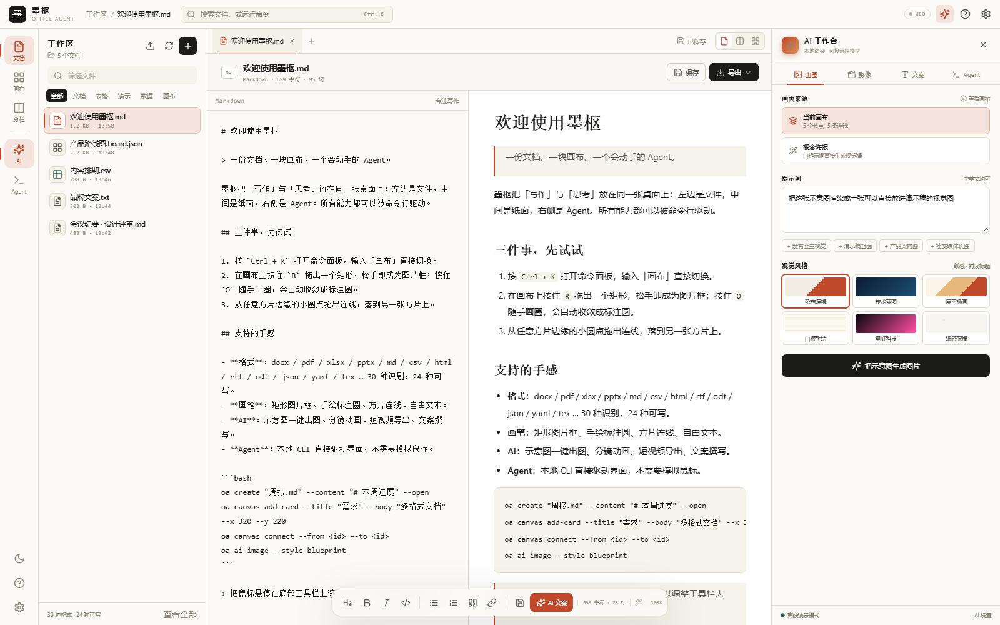

# 墨枢 Office Agent

**面向 Agent 的桌面办公工作台。** 一个本地优先的文档 / 画布 / AI 生成三合一桌面应用，把「文件系统 + 画布 + 命令行 + 模型」接到同一个界面上，让 AI Agent 可以直接读写你的办公文件、摆布画布、导出成品。

[](./LICENSE)
[](https://www.electronjs.org/)
[](https://react.dev/)
[](https://www.typescriptlang.org/)

> 数据默认只留在本机：工作区是你自己的文件夹，AI 密钥存在本地设置里，应用不收集任何使用数据。



左边是工作区文件，中间是纸面（源码 / 预览双栏），右侧是 AI 工作台——三个区域共用同一份文档状态。

---

## 它解决什么问题

日常办公里最碎的三件事——**改文档、画示意图、让模型帮忙产出内容**——通常分散在三个软件里。墨枢把它们放进一个窗口，并且对外开放一条本地命令通道，让 Agent（或你自己写脚本）能用命令行指挥界面：

```bash
oa create 周报.md --content "# 本周进展" --open
oa canvas add-card --title 需求 --body 先做减法 --x 320 --y 220
oa export pdf --name 周报.md
```

命令走的是 `127.0.0.1` 上的本地桥接，不经过任何服务器。

## 主要能力

| 模块 | 说明 |
| --- | --- |
| **多格式文档** | 30 种扩展名，8 类编辑器：富文本、Markdown、纯文本、代码、表格、PDF 阅读、幻灯片、方片画布 |
| **方片画布** | 卡片 / 矩形 / 圆形 / 连线，自由拖拽、自动整理、整块 JSON 替换，可导出成图片 |
| **AI 生成** | 配图（6 种风格）、文案（6 个渠道 × 4 种语气）、短视频（画布运镜 → WebM） |
| **成品导出** | DOCX / XLSX / PPTX / ODT / PDF / HTML / RTF / Markdown |
| **CLI 桥接** | `oa` 命令直连运行中的窗口，支持 `--json` 输出给 Agent 解析 |
| **浏览器模式** | 不装桌面端也能跑：`npm run dev` 打开即用，工作区落在 localStorage |

### 支持的格式

```
docx  doc  pdf  md  markdown  txt  rtf  odt  tex
html  htm  csv  tsv  xlsx xls  ods  pptx odp
json  yaml yml  xml  toml ini  log  sql  js  ts  py  css
```

读：全部。写 / 导出：30 种里 24 种可写，其中 DOCX、XLSX、PPTX、ODT、PDF 由内置生成器从文档模型直接序列化，不依赖 Office 安装。

## 快速开始

### 环境

- Node.js **18+**（推荐 20 / 22）
- Windows / macOS / Linux 均可开发，打包脚本默认输出 Windows x64

### 1. 桌面端（完整功能）

```bash
git clone https://github.com/ts0523/moshu-office-agent.git
cd moshu-office-agent
npm install
npm run app:dev     # 开发模式：Vite 热更新 + Electron 窗口
```

首次启动会在 `~/Documents/MoshuWorkspace` 下创建工作区（`exports/` 是导出目录），并放几份示例文件。

### 2. 只跑网页版（免 Electron）

```bash
npm run dev         # 打开 http://localhost:5173
```

网页版没有真实文件系统，工作区存在浏览器 localStorage 里，适合看界面、试画布。

### 3. 用打包好的桌面端

```bash
npm run start       # 构建前端 + 启动 Electron
npm run dist        # 用 electron-packager 打出 release/ 目录
```

Windows 上也可以双击 `启动墨枢.bat`（首次会自动 `npm install`）。

## 配置 AI（自带 Key）

应用**不自带任何模型额度**，所有远程调用走你自己的 OpenAI 兼容接口。打开「设置」填写：

| 字段 | 示例 |
| --- | --- |
| Base URL | `https://api.openai.com/v1` 或任意兼容网关 |
| API Key | `sk-...` |
| 文本模型 | `gpt-4o-mini`（可留空） |

- Key 只保存在本机设置里，请求由主进程代理发出，不受浏览器跨域限制。
- **不填 Key 也能用**：配图、文案、短片会走内置的本地渲染引擎（离线可用，效果是模板化的）。
- 调用失败时自动回落到本地引擎并在结果里注明，不会静默失败。

## CLI 参考

```bash
npm run cli -- status      # 或者装到全局后用 oa status
```

```
工作区
  oa status                     桥接状态 / 工作区 / 画布概况
  oa list [--json]              列出工作区文件
  oa create <名称> [--content] [--format md] [--open]
  oa read <名称>                读取（在线支持 docx / pdf）
  oa write <名称> --content 文本
  oa append <名称> --content 文本
  oa open <名称> | oa rm <名称>

画布
  oa canvas list | add-card | add-rect | add-circle | connect | layout | set | export | clear
  oa doc info [--json]          当前文档字数 / 大纲

AI
  oa ai image  [--style blueprint|editorial|flat|sketch|neon|plain]
  oa ai video  [--title 片名] [--mode video|animation]
  oa ai copy   --topic "主题" [--channel xiaohongshu|wechat|email|speech|summary|product]

导出
  oa export pdf|docx [--name 文档.md]
  oa view doc|board|split
```

画布、AI、导出这三组命令需要桌面端在运行（`npm run app`）；纯文本文件在离线时也能读写。

## 目录结构

```
electron/          主进程：窗口、文件 IPC、HTTP/WS 桥接、打印导出
  main.mjs         桥接服务（默认 127.0.0.1:17885，被占用时自动 +1）
  preload.cjs      window.moshu 暴露的受限 API
cli/oa.mjs         独立 CLI，发现 bridge.json 后与窗口通信
src/
  components/      界面：标题栏、文件面板、文档视图、画布、AI 面板、弹窗
  lib/
    agent.ts       命令分发（CLI 与界面共用同一套动作）
    ai.ts          远程模型调用 + 本地文案引擎
    aiVideo.ts     画布运镜 → MediaRecorder → WebM
    boardRender.ts 画布渲染（6 种视觉风格）
    formats.ts     30 种格式的读写能力矩阵
    writers.ts     DOCX / XLSX / PPTX / ODT / PDF / HTML 序列化
    fsapi.ts       桌面 IPC 与浏览器 localStorage 双实现
```

## 开发脚本

| 命令 | 作用 |
| --- | --- |
| `npm run dev` | Vite 开发服务器（浏览器模式） |
| `npm run app` | 直接启动 Electron（需先 `npm run build`） |
| `npm run app:dev` | 开发模式：Vite + Electron 同时起 |
| `npm run build` | 构建前端到 `dist/` |
| `npm run typecheck` | TypeScript 全量检查 |
| `npm run dist` | 打包 Windows x64 桌面端 |
| `npm run cli -- <命令>` | 运行 CLI |

## 安全与隐私

- 工作区、导出、密钥**全部在本机**，应用不上传文件、不做埋点。
- 桥接只监听 `127.0.0.1`，不暴露到局域网；`bridge.json` 只记录端口与工作区路径。
- 渲染进程有 CSP 限制，`contextIsolation` 开启，文件操作全部经 preload 白名单。
- 远程模型的请求会发给你自己配置的地址——**这部分数据流向由你决定**。

## 参与贡献

见 [CONTRIBUTING.md](./CONTRIBUTING.md)。Issue / PR 都欢迎，提 Bug 时请附上系统版本、复现步骤和 `dev.log` 相关片段（**先确认里面没有你的密钥**）。

## License

[MIT](./LICENSE) © 2026 Moshu Studio

---

<sub>English: Moshu Office Agent is an MIT-licensed, local-first desktop workspace for document editing, a node canvas, and agent-driven content generation. It runs on Electron + React + Vite, supports 30 file formats, exports DOCX/XLSX/PPTX/PDF, and exposes a local `oa` CLI bridge at `127.0.0.1` so agents can drive the UI. Bring your own OpenAI-compatible API key; without one it falls back to a built-in offline render engine.</sub>
